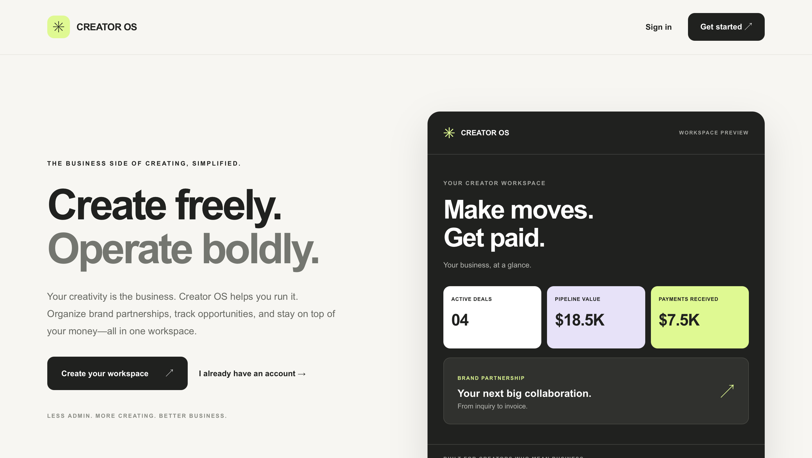
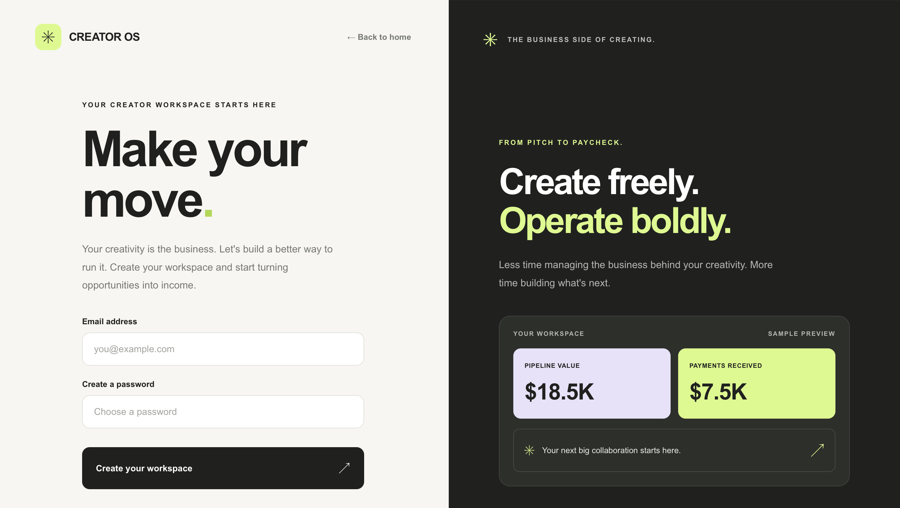
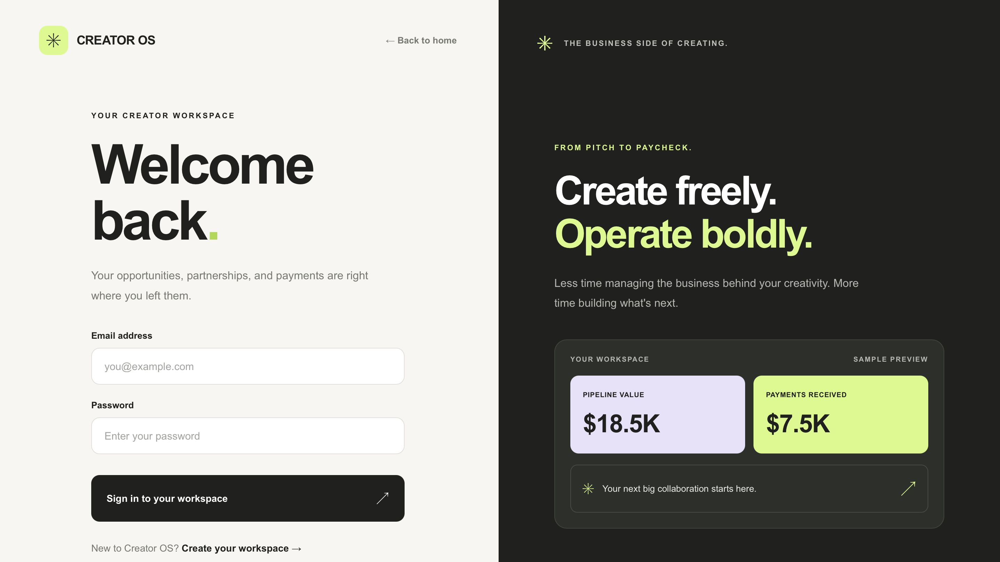
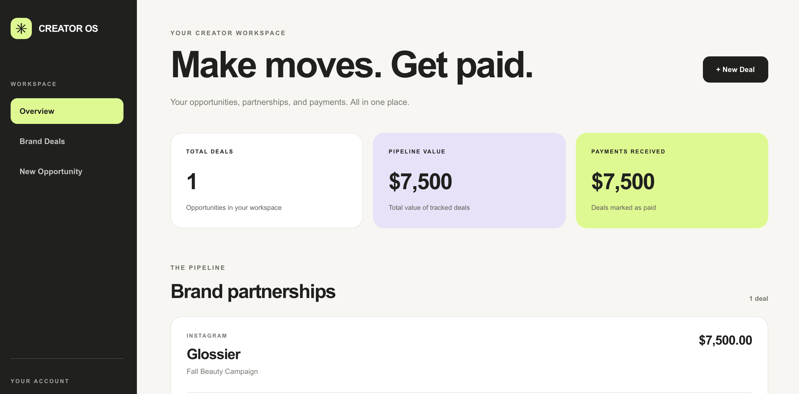

# Creator OS

**Create freely. Operate boldly.**

Creator OS is a full-stack web application designed to simplify the business side of content creation.

Built around the idea of taking creators **from pitch to paycheck**, Creator OS helps users organize brand partnerships, manage opportunities, monitor deal progress, and track payments all from one workspace.

## Screenshots

### Homepage



### Sign Up



### Login



### Dashboard



## Features

- **User authentication:** Create an account, sign in, and securely log out.
- **Personalized dashboard:** Access a workspace displaying your own brand partnerships.
- **Brand deal management:** Create, view, edit, and delete opportunities.
- **Opportunity tracking:** Organize campaign details, platforms, deal values, deadlines, and notes.
- **Deal pipeline:** Track opportunities through stages including Inquiry, Negotiating, Contracted, In Progress, and Completed.
- **Payment tracking:** Monitor invoice and payment statuses.
- **Dashboard metrics:** View total deals, pipeline value, and payments received.

## Tech Stack

**Frontend**
- HTML
- CSS
- JavaScript
- EJS

**Backend**
- Node.js
- Express.js
- Passport.js

**Database**
- MongoDB Atlas

## Getting Started

### 1. Clone the repository

Clone the project to your local machine and open the project directory.

### 2. Install dependencies

```bash
npm install
```

### 3. Configure environment variables

Create a `.env` file in the project's root directory and add:

```env
MONGODB_URI=your_mongodb_connection_string
SESSION_SECRET=your_session_secret
```

Replace the placeholder values with your own configuration.

**Important:** Never commit your `.env` file or expose database credentials.

### 4. Start the application

```bash
node server.js
```

### 5. Open the application

Visit `localhost:8080` in your browser.

## Live Application

**[Launch Creator OS](https://creator-os-issn.onrender.com)**

Explore the live application, create an account, and manage brand partnerships from your personal creator workspace.

## Product Vision

### From Pitch to Paycheck

Creator OS is envisioned as a comprehensive business operating system for the modern creator.

As the creator economy evolves, independent creators are increasingly operating as entrepreneurs, managing partnerships, negotiating agreements, producing deliverables, tracking revenue, and maintaining relationships with brands.

Yet many of the tools supporting these activities remain fragmented across spreadsheets, email, documents, and separate business applications.

Creator OS aims to bring these workflows together into a centralized, intuitive workspace that helps creators operate with greater efficiency, visibility, and ownership.

**The long-term vision is to give creators the infrastructure to manage the business behind their creativity so they can spend less time navigating administrative complexity and more time creating, growing, and building sustainable businesses.**

## Current MVP

The initial release focuses on the foundational workflows involved in managing brand partnerships.

**Implemented capabilities include:**

- Secure account registration, login, and logout.
- Authenticated, user-specific dashboards.
- Brand partnership and sponsorship opportunity tracking.
- Full CRUD functionality for creating, viewing, editing, and deleting deals.
- Campaign information, platforms, deal values, deadlines, and notes.
- Deal pipeline stages from initial inquiry through completion.
- Invoice and payment status tracking.
- Dashboard metrics displaying total deals, pipeline value, and payments received.
- Persistent data storage using MongoDB Atlas.
- Responsive interface designed around creator business workflows.

This MVP establishes the foundation for a broader platform while demonstrating the core functionality of an authenticated full-stack application.

## Future Features / Product Roadmap

The following capabilities represent the broader product vision and are **planned or exploratory features, not functionality currently implemented in the MVP**.

### 1. AI-Powered Business Assistance

Introduce intelligent tools to help creators streamline business operations and make more informed decisions.

Potential capabilities include:

- AI-assisted sponsorship proposals and outreach.
- Personalized workflow recommendations.
- Assistance with campaign planning and deliverable organization.
- Opportunity identification and prioritization.
- Intelligent summaries of business activity and upcoming obligations.
- Contextual guidance for navigating creator business workflows.

### 2. Contract Management & Deal Intelligence

Expand Creator OS into a centralized workspace for managing sponsorship agreements and contractual obligations.

Potential capabilities include:

- Contract storage and organization.
- Agreement status tracking, from review and negotiation through execution.
- Contract renewal and expiration reminders.
- Deliverable requirements and milestone tracking.
- Exclusivity period tracking and potential conflict alerts.
- Content licensing and usage-rights tracking.
- Visibility into governing-law provisions.
- FTC disclosure and advertising compliance reminders.
- Archived agreements and historical contract records.

The objective is to help creators maintain visibility into the commitments associated with their partnerships and identify issues that may require professional review.

### 3. Invoicing, Payments & Financial Operations

Develop financial management tools that help creators move from completed deliverables to collected revenue.

Potential capabilities include:

- Invoice creation and management.
- Payment processing integrations.
- Outstanding balance tracking.
- Automated payment reminders.
- Revenue forecasting.
- Financial records and transaction histories.
- Income reporting and exportable financial summaries.

### 4. Brand Relationship Management

Introduce relationship management tools tailored to the commercial needs of creators.

Potential capabilities include:

- Centralized brand and agency contact records.
- Partnership histories and collaboration timelines.
- Contact notes and relationship context.
- Follow-up reminders and outreach tracking.
- Repeat partnership identification.
- Relationship management across multiple campaigns.

### 5. Business Analytics & Performance Insights

Provide creators with greater visibility into the performance and growth of their businesses.

Potential capabilities include:

- Revenue dashboards and historical trends.
- Partnership performance analytics.
- Earnings by brand, platform, and campaign.
- Deal conversion and pipeline insights.
- Revenue forecasting and business growth indicators.
- Downloadable reports and business summaries.

### 6. Workflow Automation & Operational Management

Reduce repetitive administrative work through integrated workflows and automation.

Potential capabilities include:

- Automated reminders for deadlines, deliverables, and payments.
- Campaign milestone tracking.
- Follow-up scheduling.
- Recurring administrative workflows.
- Notifications for outstanding obligations.
- Centralized activity and task management.

### 7. Creator Business Infrastructure

Explore additional capabilities that support creators as independent businesses.

Potential areas of expansion include:

- Creator media kits and professional business profiles.
- Campaign and deliverable management.
- Business document organization.
- Integrations with existing creator tools and platforms.
- Collaboration workflows for creators, managers, and teams.
- Additional operational and financial planning resources.

## Long-Term Direction

Creator OS is being developed around a broader thesis: **creators are businesses, and they deserve tools designed for the complexity and potential of the businesses they are building.**

The goal is not simply to track sponsorships. It is to create an integrated operating environment that gives creators greater visibility, control, and leverage over their commercial activities.

The current application is an initial step toward that vision.

## Acknowledgments

The authentication foundation was adapted from the Savage Auth starter project, which draws on Scotch.io's authentication tutorial.

---

**Creator OS — Your work. Your business. Your way.**